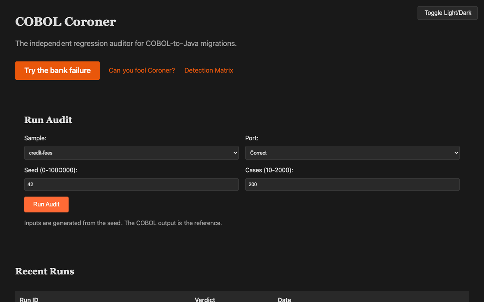
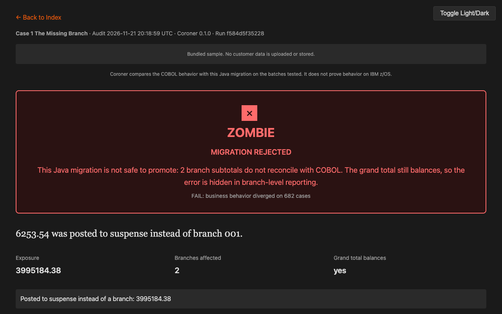
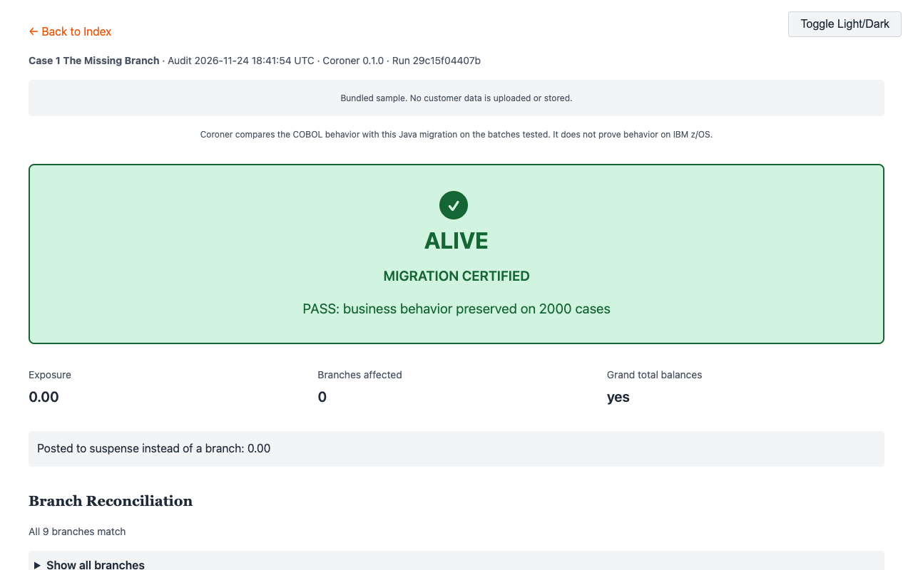
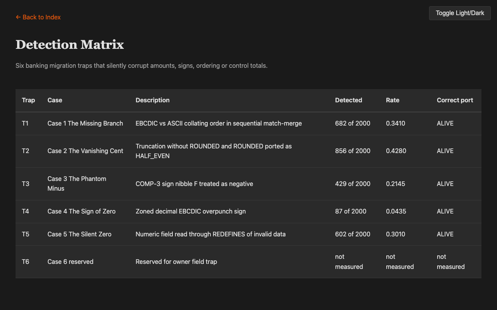
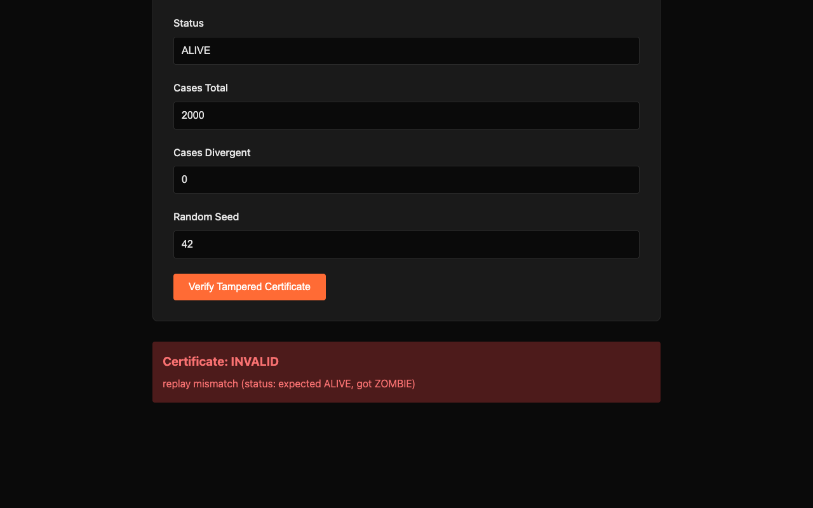
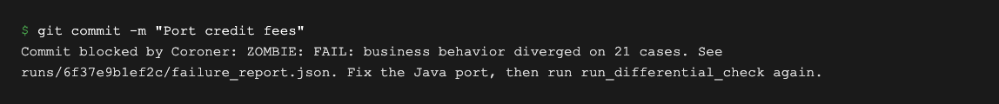

# COBOL Coroner

**The independent regression auditor for COBOL-to-Java migrations.**

Live demo: https://coroner.iqoba.com (deployment check passed on 2026-11-21, all 10 checks, see [docs/deploy.md](docs/deploy.md))



It checks whether a migration kept the business behavior on N generated cases, and shows exactly where it broke.

COBOL Coroner does not just compare outputs. It detects the banking migration traps that silently corrupt totals, control breaks and data ordering.

> AI accelerates. Coroner certifies.

Coroner does not translate COBOL. AWS Transform, Kiro, an LLM or a human migrates COBOL to Java. Coroner independently verifies the result.

Give it:
- a batch COBOL program and its copybooks,
- its Java 17 version,
- a `schema.json` describing input and output columns.

Coroner runs both programs on the same generated test cases, compares the outputs field by field with no numeric tolerance, and returns one of three results:

- **ALIVE**: PASS: business behavior preserved on N cases (0 divergence found).
- **ZOMBIE**: FAIL: business behavior diverged on M cases, with the failing case, the COBOL output, the Java output, the divergent field and the COBOL lines executed.
- **ERROR**: the COBOL reference did not run. The Java port is never blamed for it, and no verdict or certificate is written.

## Try it in 60 seconds

Six links on the live site. Each step says what you should see.

1. [Case 1, faulty port](https://coroner.iqoba.com/run/f584d5f35228): ZOMBIE, "MIGRATION REJECTED", "FAIL: business behavior diverged on 682 cases", exposure 3995184.38 across 2 branches, grand total balances: yes. Branch 001: COBOL 2025606.03, Java 0.00.
2. On that page, press Verify: "Certificate: VALID" (the audit is replayed; it takes a few seconds).
3. [Tamper with it](https://coroner.iqoba.com/tamper?run_id=f584d5f35228): set Cases Divergent to 0 and press "Verify Tampered Certificate": "Certificate: INVALID" with "replay mismatch (cases_divergent: expected 0, got 682)".
4. [Case 1, correct port](https://coroner.iqoba.com/run/29c15f04407b): ALIVE, "MIGRATION CERTIFIED", "PASS: business behavior preserved on 2000 cases", "All 9 branches match".
5. [Detection Matrix](https://coroner.iqoba.com/matrix): Cases 1 to 5 detected on their faulty ports (682, 856, 429, 87 and 602 of 2000) and ALIVE on every correct port; Case 6 reserved, not measured.
6. [The bank failure story](https://coroner.iqoba.com/story): Case 1 told in 8 steps, with a Business view and an Engineer view.

To run your own audit, use the Run Audit form on the [home page](https://coroner.iqoba.com/).

## Where to start

- [docs/judge-guide.md](docs/judge-guide.md): check every claim yourself, five minutes with no install, fifteen minutes with Docker.
- [docs/KIRO_USAGE.md](docs/KIRO_USAGE.md): how Kiro was used, with links to the evidence.
- [docs/architecture.md](docs/architecture.md): modules and repository layout.
- [docs/ACCESSIBILITY.md](docs/ACCESSIBILITY.md): accessibility checks the tests run, the manual browser checks, and their limits.
- [docs/deploy.md](docs/deploy.md): the deployment guide, with measured outputs.
- [docs/static/index.html](docs/static/index.html): static copy of real outputs, readable without the live site.
- [samples/independence/TABLE.md](samples/independence/TABLE.md): the same audit on ports from different sources.
- [samples/carddemo-cbact04c/README.md](samples/carddemo-cbact04c/README.md): the audit of one path of AWS's CardDemo sample.
- [powers/coroner-audit/](powers/coroner-audit/): the Kiro power that exposes Coroner tools to a Kiro agent.
- [docs/decisions.md](docs/decisions.md): the decision log.
- [docs/reviews.md](docs/reviews.md): the dated review log, with every measurement.
- [CHANGELOG.md](CHANGELOG.md): changes by date, and the open items.
- [SECURITY.md](SECURITY.md): how to report a vulnerability, and the controls of the live demo.
- [CONTRIBUTING.md](CONTRIBUTING.md): setup, tests and rules for changes.
- [docs/PREEXISTING_CODE.md](docs/PREEXISTING_CODE.md): what was not written for this project, with its licences.

## The cases

Six banking migration traps that silently corrupt amounts, signs, ordering or control totals.

Coroner prioritizes high-impact banking migration traps, such as EBCDIC collating sequence and control-break errors, and demonstrates their detection with executable differential tests: targeted regression traps within its supported COBOL subset.

| Case | Trap | Description | Detected (faulty port) | Rate | Correct port |
|------|------|-------------|------------------------|------|--------------|
| Case 1: The Missing Branch | T1 | EBCDIC vs ASCII collating order breaks control-break subtotals | 682 of 2000 | 0.3410 | ALIVE |
| Case 2: The Vanishing Cent | T2 | Truncation without ROUNDED, and ROUNDED ported as HALF_EVEN | 856 of 2000 | 0.4280 | ALIVE |
| Case 3: The Phantom Minus | T3 | A positive amount read as negative. Packed-decimal sign nibble F interpreted as a minus sign by the Java port. COMP-3 sign nibble (C positive, D negative, F unsigned) | 429 of 2000 | 0.2145 | ALIVE |
| Case 4: The Sign of Zero | T4 | Zoned sign overpunch in input files; reference compiled with -fsign=EBCDIC; the faulty port forgets the zero overpunch characters { and } | 87 of 2000 | 0.0435 | ALIVE |
| Case 5: The Silent Zero | T5 | REDEFINES and invalid numeric data | 602 of 2000 | 0.3010 | ALIVE |
| Case 6: The Cursed Modulo | T6 | A rotation slot from a negative day offset. COBOL FUNCTION MOD takes the sign of the divisor, the Java % operator keeps the sign of the dividend | 636 of 2000 | 0.3180 | ALIVE |

Run all traps:

```bash
make traps
```

T1 Unreconciled branch exposure (faulty port): sum 3995184.38, max 2025606.03, 2 branches affected, suspense difference 3995184.38, grand total matches: yes.

The suspense line is not counted as a branch: the amount missing from branches 001 and 9ZZ appears in suspense, which is why the grand total still balances.

Detection rates depend on the generator settings of each trap (schema.json domain_weights for T1, tie_share for T2, etc.) and are not real-world statistics.

Case 6 (T6) measured on a catalog run in a temporary base (2000 cases, seed 42): faulty run e3919aefc333 (ZOMBIE, 636 of 2000 cases), correct run 35909d3fe97d (ALIVE). The divergent cases are exactly the negative day offsets that are not multiples of 7. The case README, [samples/traps/T6-cursed-modulo/README.md](samples/traps/T6-cursed-modulo/README.md), lists the public sources.

The branch-code mix of T1 is a generator setting (schema.json domain_weights), not a real-world statistic.

## Features and honest limits

| Feature | What it does | Honest limit |
|---|---|---|
| Differential audit | Runs the COBOL and the Java program on seeded generated cases and compares every output field, with no numeric tolerance. | ALIVE means "business behavior preserved on N cases". It is not a formal proof. |
| Reference runtime | Uses GnuCOBOL 3.x as the reference. | Validated under GnuCOBOL 3.x only, not IBM Enterprise COBOL. No z/OS emulation. |
| Scope | Audits standalone batch programs. | CICS, DB2, IMS, VSAM, JCL and multi-program applications are out of scope. |
| Replayable certificate | Records file hashes, the seed and the verdict. Replay reruns the audit. | Proved by replaying the audit, not by a cryptographic signature. |
| Detection Matrix | Counts the cases each trap detects in its faulty port. | Six traps, each a small program written for this project. All six are measured (2000 cases, seed 42). Rates depend on generator settings, not real-world statistics. |
| Money figure | Shows branch exposure for Case 1, and amounts affected and the largest difference for Cases 2 to 5. | No currency. Cases 3 and 4 show large values because generated amounts cover the whole field range. Case 6 shows no money figure: a rotation slot is a code, not an amount. |
| Commit gate | Blocks a ZOMBIE commit, push or merge through the Kiro gate, the Git pre-commit hook and CI. | It does not stop an agent from writing code. |
| Kiro power | Exposes Coroner tools to a Kiro agent. | Measured in the Kiro IDE on Windows. The IDE was not run on macOS. |
| Live demo | Audits with 10 to 2000 cases per run, with a job queue of 3 by default and per-client rate limits. | Queue and limits are set in the code: 5 Run audit requests per minute and 1 Verify per 10 seconds per client, 20 API requests per minute per client, 100 per minute overall. |

## Real-world sample: CardDemo

Coroner audits a Kiro-generated Java port of one bounded interest-calculation path in AWS's open-source CardDemo sample (program CBACT04C).

Uses AWS's open-source CardDemo sample (Apache 2.0). Not affiliated with or endorsed by AWS.

Result: ALIVE on 200 generated cases, seed 42 (run a5edaf1924a5), and the certificate replays VALID. No behavioral difference across the tested scenarios; not a certification for all inputs.

Two findings from the audit:

- The upstream data uses the EBCDIC sign convention, so every program of the sample is compiled with `-fsign=EBCDIC`.
- CBACT04C never adds the interest of the last account of a run to that account's balance. The Java port keeps this behavior.

Details, the adaptation and the licence are in [samples/carddemo-cbact04c/README.md](samples/carddemo-cbact04c/README.md).

## Independence

The same Case 1 audit (T1, 2000 cases, seed 42) was applied to Java ports from different sources. [samples/independence/TABLE.md](samples/independence/TABLE.md) lists each one:

- a port by Claude Opus 5.5, run as a Claude Code subagent: ALIVE, 0 of 2000 cases divergent;
- a port by a Kiro agent in session 1: ZOMBIE, 682 of 2000 cases divergent;
- a port by a Kiro agent in a fresh, isolated session: ALIVE, 0 of 2000 cases divergent.

No port written by hand is included: none was written before the deadline.

## Screenshots

All screenshots produced by `make screenshots` from real runs.


*Case 1, The Missing Branch, faulty port: ZOMBIE on 682 of 2000 cases. 6253.54 is posted to suspense instead of branch 001, and the grand total still balances.*


*Case 1, The Missing Branch, correct port: ALIVE, business behavior preserved on 2000 cases (light theme).*


*Detection Matrix: Cases 1 to 5 measured (detected cases of 2000, rate, correct port ALIVE), Case 6 reserved and not measured.*


*Tamper page: run f584d5f35228 (Case 1, faulty port) edited to ALIVE with 0 divergent cases; the replay gives Certificate: INVALID, replay mismatch (status: expected ALIVE, got ZOMBIE). The page does not print the run id; it is in the address of the page (/tamper?run_id=f584d5f35228).*


*Git commit of the HALF_EVEN variant of the credit-fees port, blocked by the Coroner pre-commit hook: ZOMBIE on 21 cases (500-case check).*

## Quick start

### With Docker (no COBOL or Java on your machine)

You need Docker with Compose. The compose file pulls a prebuilt image pinned by digest, so no login is needed.

```bash
docker compose up -d
```

The first start takes about one minute, because the bundled demo runs are generated. The operator's Mac measured 47 seconds ([docs/deploy.md](docs/deploy.md)). Then open http://127.0.0.1:8000. Stop with `docker compose down`.

### On your machine (GnuCOBOL and JDK 17 installed)

Prerequisites: GnuCOBOL 3.2, JDK 17, Python 3.12.

```bash
python3.12 -m venv .venv
.venv/bin/pip install -e ".[dev]"
make test
make demo
make zombie
make acceptance
make junit-jars
make pbt  # jqwik properties of the Case 1 Java ports
make serve  # starts the UI at http://127.0.0.1:8000
```

The default `make test` runs the tests that are not marked slow in parallel (pytest-xdist, one test file per worker); `make test-serial` runs the same tests in one process. Measured on the development Mac on 2026-11-21: about 3.3 minutes in parallel and 7.7 minutes serial, so the earlier 60 second target is not met. `make test-all` runs all tests including slow ones. `make acceptance` runs the 2,000-case acceptance tests (10 seeds, catalog, takes about 10 minutes).

CLI form:

```bash
python -m coroner verify --cobol COBOL_FILE --copybooks COPYBOOK_DIR --java JAVA_FILE --schema SCHEMA_JSON [--cases N] [--seed S] [--timings]
```

Exit codes of `verify` in run mode: 0 = ALIVE, 1 = ZOMBIE, 2 = ERROR (the COBOL reference did not run, or an input was refused).

Exit codes of a certificate replay (`python -m coroner verify <certificate.json>`): 0 = valid ALIVE, 1 = valid ZOMBIE, 3 = INVALID.

## What a run writes

Every run stores artifacts in `runs/<run_id>/`:

- `inputs.json`: input hashes, seed, tool versions, case count
- `generated_cases.csv`: synthetic test cases
- `comparison_results.json`: COBOL and Java outputs aligned by case
- `coverage_report.json`: paragraph and branch coverage
- `verdict.json`: the final verdict with sub-label
- `failure_report.json`: (ZOMBIE only) minimal case details and executed lines
- `ZombieRegressionTest.java`: (ZOMBIE only) JUnit 5 test that reproduces the divergence

Credit-fees sample, correct port, 2,000 cases (`make demo`):

```
ALIVE: PASS: business behavior preserved on 2000 cases
Paragraph coverage 12/12
Branch coverage (Coroner definition) 42/70
Validated under GnuCOBOL 3.x
```

Credit-fees sample, HALF_EVEN variant from make zombie (a rounding bug), 2,000 cases:

```
ZOMBIE: FAIL: business behavior diverged on 86 cases
Paragraph coverage 12/12
Branch coverage (Coroner definition) 42/70
Validated under GnuCOBOL 3.x
```

Note: Branch coverage counts only the branches reached by generated valid inputs. Input-validation error paths are not generated.

## Property-based testing

Coroner generates its cases from `schema.json` with `random.Random(seed)`, using `random()` only, so the same seed gives the same cases. Values are drawn by magnitude (number of digits first, then the digits), string columns come from the schema domain, rounding ties are added for fee-and-rate schemas (6 % of the cases by default), and batch schemas (Case 1) get 5 to 25 rows per case. It does not generate deliberate boundary values: the limit and boundary helpers in `coroner/gen` are not called by an audit.

The property checked on every generated case: the Java output equals the COBOL output, field by field, with no numeric tolerance, and both exit with the same status.

A second property holds for each Case 1 batch: the branch subtotals plus suspense equal the grand total. The faulty port keeps it while it moves the amounts of branches 001 and 9ZZ to suspense, which is why a total-only check does not see the error. Coroner compares every output row, the TOTAL row included, and reports whether the grand total matches.

The tests of these properties:

- `tests/test_compare.py`: four Hypothesis properties of the normalizer (idempotence of decimal and string normalization, extra decimals are divergent and never rounded, only trailing spaces are trimmed). `tests/conftest.py` makes them reproducible.
- `make pbt`: three jqwik properties on the two Java ports of Case 1 (`samples/traps/T1-ebcdic-match-merge/java/property/MatchMergeProperties.java`, jqwik 1.10.2, 30 tries each, seed 42): the correct port conserves the total, the faulty port conserves it too, and for a batch with a branch 001 transaction the faulty port posts it to suspense where the correct port posts it to branch 001. It runs the ports and asserts no COBOL output. `tests/test_property_t1.py` runs it.

## The full chain

> Kiro translates. Coroner certifies. Git and Jenkins enforce the verdict.

A Kiro agent ports the COBOL program, and Coroner audits the port through MCP. The Kiro agent's preToolUse gate blocks `git commit`, `git push` and `git merge` unless the certificate of the migration replays as ALIVE. The Git pre-commit hook blocks a ZOMBIE commit. The CI gate (`.github/workflows/coroner-gate.yml`) enforces the same verdict in a pipeline, and the replayable certificate records the result.

Coroner does not block the agent from writing code. It blocks a ZOMBIE migration from being committed or pushed.

The stop hook re-prompts the agent up to 3 times (v2 engine) or once per turn (v3 engine). It does not keep the agent working until the verdict is ALIVE.

The Git pre-commit hook runs a fast 500-case check on the demo sample staged content and blocks ZOMBIE commits. It audits exactly what will be committed, not the working tree. The `git commit --no-verify` bypass is available to the owner under their responsibility.

The evidence for each hook is in [docs/KIRO_USAGE.md](docs/KIRO_USAGE.md), section 4.

## Kiro power

The coroner-audit power runs in the Kiro IDE 1.4.178 on Windows 10 x64. Through the installed power, Kiro called run_differential_check (run f584d5f35228, ZOMBIE on 682 of 2000 cases), get_verdict, get_failure_report and verify_certificate, and the certificate verified as valid.

The evidence is in [docs/evidence/kiro-power-run.md](docs/evidence/kiro-power-run.md), and the power files are in [powers/coroner-audit/](powers/coroner-audit/).

## Kiro skills

Three skills guide the coroner-auditor agent:
- `banking-trap-recognition`: Recognize the six banking migration traps in COBOL and Java (EBCDIC collation, rounding, COMP-3 sign, zoned overpunch, REDEFINES, modulo of a negative value).
- `cobol-semantics-safety`: COBOL semantic rules a Java port must preserve (rounding to HALF_UP, truncation to DOWN, BigDecimal with explicit scale, sign handling, EBCDIC collating sequence).
- `coroner-audit-workflow`: End-to-end workflow from run_differential_check to certificate verification.

## Demo

The integrated demo runs trap T1 (EBCDIC collating order) with both faulty and correct Java ports, verifies the JUnit regression test, and replays the certificate.

Run the demo:

```bash
make demo-ebcdic
```

The demo performs five steps: verify the faulty port, print the Given/When/Then card of the minimal case with its COBOL lines, run the exported JUnit test against both ports, replay the certificate, and verify the correct port.

Measured output (operator run 2026-11-16, 2000 cases, seed 42):

```
ZOMBIE: FAIL: business behavior diverged on 682 cases
Unreconciled branch exposure: sum 3995184.38, max 2025606.03, 2 branches affected, suspense difference 3995184.38, grand total matches: yes
Then COBOL writes row BRANCH=001 with SUBTOTAL=+0006253.54, Java does not
Then Java writes row BRANCH=SUSP with SUBTOTAL=+0006253.54, COBOL does not
JUnit against faulty port: failed (1 tests found, 0 successful, 1 failed)
JUnit against correct port: passed (1 tests found, 1 successful, 0 failed)
Certificate: VALID
ALIVE: PASS: business behavior preserved on 2000 cases
```

The grand total matches in both the faulty and correct runs, which is why a total-only reconciliation would not catch this faulty port.

## CI gate

The CI gate blocks builds when a Java migration is ZOMBIE, the certificate is missing, or the certificate is invalid.

Run locally:

```bash
make coroner-gate
```

Exit codes:
- 0: ALIVE verdict and VALID certificate
- 1: ZOMBIE verdict, missing certificate, or invalid certificate
- 2: ERROR (reference did not run) or scope file error

- `.github/workflows/coroner-gate.yml`: builds the image for linux/amd64, runs `python3 -m coroner gate` inside it (2,000 cases), and a second job checks that the HALF_EVEN variant is blocked with exit code 1.
- `Jenkinsfile`: an example declarative pipeline (Groovy) that runs the same gate in the image and publishes its JUnit report; it is not run by this repository.

Check an existing certificate against the current files:

```bash
make coroner-gate GATE_ARGS="--certificate runs/<run id>/certificate.json"
```

Coroner is a behavioral regression gate, not a SonarQube replacement.

## Schema format

The `schema.json` file describes input and output columns. Optional column options for decimal input fields:

- `amount_range`: Constrains generated amounts to a realistic range. Example: `{"min": "0.01", "max": "9999.99"}` limits amounts to this range with the column's declared scale. When absent, amounts are drawn from the full PIC range by magnitude.

- `negative_share`: Probability that a generated amount is negative (a reversal). Example: `0.05` means 5% of amounts are negative. Must be between 0.0 and 1.0. When absent, signed amounts are 50% positive and 50% negative.

Both options use the same seeded random number generator as other fields, so the same seed produces the same cases.

Example from T1 schema:

```json
{
  "name": "AMOUNT",
  "type": "decimal",
  "pic": "S9(7)V99",
  "sign": true,
  "scale": 2,
  "amount_range": {"min": "0.01", "max": "9999.99"},
  "negative_share": 0.05
}
```

## Status

Built for Kiroween 2026 (category: Resurrection). Open items are listed in CHANGELOG.md.

## What Coroner is not

- Not a converter.
- Not a formal proof of equivalence. An ALIVE verdict means "business behavior preserved on N cases", nothing more.
- Validated under GnuCOBOL 3.x only, not IBM Enterprise COBOL. GnuCOBOL vs IBM differences are documented in docs/evidence/gnucobol-encodings.md (sign nibble B, sign conventions). Coroner does not emulate z/OS. No S0C7 is raised by GnuCOBOL.
- Return codes are compared as OS exit statuses, which are limited to 0 to 255 (a COBOL RETURN-CODE outside that range is reduced by the operating system).

## Out of scope (V1)

CICS, DB2, IMS, VSAM, JCL, EBCDIC-encoded data (the EBCDIC collating sequence trap is in scope), multi-program applications, Pacbase, target languages other than Java 17.

## Limitations

- COMP-3 sign nibbles B, A, E and other non-preferred nibbles are excluded from certified cases (GnuCOBOL reads B as positive, IBM documentation treats B as negative). Coroner tests use only preferred sign nibbles C (positive), D (negative), and F (unsigned/positive).

## How we used Kiro

Kiro wrote the code, specs, tests and hook files. An operator wrote the prompts, checked every result on real runs and sent back what was wrong.

**Specs.** [.kiro/specs/](.kiro/specs/) holds 16 spec folders, each with requirements.md, design.md and tasks.md. Two examples:
- [engine](.kiro/specs/engine/requirements.md): takes a COBOL program, its copybooks, a Java 17 version and a schema, runs both on generated cases and returns ALIVE or ZOMBIE.
- [kiro-hooks](.kiro/specs/kiro-hooks/requirements.md): the delivery gate blocks git commit, push and merge while the certificate replays as ZOMBIE, missing or invalid.

Details: [section 2 of docs/KIRO_USAGE.md](docs/KIRO_USAGE.md#2-specs).

**Steering.** Seven files in [.kiro/steering/](.kiro/steering/), all marked `inclusion: always`:
- product.md: Coroner verifies and never converts; the verdict never depends on an AI model.
- quality.md: short code, fixed seeds, reference outputs only from running the COBOL program.
- public-repo.md: no private, client or competitor names.
- no-formal-proof.md: wording limits, such as never "formal proof" or "guaranteed".
- cobol-semantics.md: COBOL rounding and sign rules for the Java side.
- comparison-rules.md: exact comparison after normalization, no numeric tolerance.
- scope-v1.md: what is in and out of scope for V1.

**Hooks.** Five files in [.kiro/hooks/](.kiro/hooks/), one hook per file:
- coroner-commit-gate.json: blocks git commit, push and merge when the scope certificate is ZOMBIE, missing or invalid.
- coroner-stop-check.json: when the agent stops, asks it to continue while the verdict is ZOMBIE, at most 3 requests per session.
- fast-tests-on-save.json: runs the matching fast test file after a Python file under coroner/ or tests/ is saved.
- public-repo-check.json: before a git commit, blocks added em or en dashes, home paths and unlisted files at the root or in scripts/.
- trap-catalog-refresh.json: after a trap sample is saved, asks the agent to run make traps and report what the catalog file says.

The commit gate and the stop check are also wired in the custom agent for kiro-cli. The IDE hook files were not run in the Kiro IDE, because the IDE does not run on macOS 12 ([section 4 of docs/KIRO_USAGE.md](docs/KIRO_USAGE.md#4-hooks-and-the-gate)).

**Skills.** Three folders in [.kiro/skills/](.kiro/skills/), loaded by the custom agent:
- banking-trap-recognition: the six banking migration traps in COBOL and Java.
- cobol-semantics-safety: COBOL rules a Java port must keep, such as rounding and BigDecimal scale.
- coroner-audit-workflow: the audit steps, from run_differential_check to the verdict and its failure details.

**Custom agent.** [.kiro/agents/coroner-auditor.json](.kiro/agents/coroner-auditor.json) audits Java ports with the Coroner MCP tools and reports only what Coroner outputs. Its first run had no tools list, and the model printed an invented verdict with branch coverage 42/70. The next run made real tool calls, and its values match the measured 200-case run ([section 5 of docs/KIRO_USAGE.md](docs/KIRO_USAGE.md#5-mcp-and-the-coroner-auditor-agent)).

**MCP power.** [powers/coroner-audit/](powers/coroner-audit/) exposes the 7 Coroner tools to a Kiro agent. It ran in the Kiro IDE on Windows 10 on 2026-11-21, and Kiro called the tools on Case 1 ([docs/evidence/kiro-power-run.md](docs/evidence/kiro-power-run.md)).

**Kiro surprised us.** Checking the Case 1 minimal case against run f584d5f35228 showed that the run's own card was right: case GEN-001525, branch 001, amount 6253.54. The trap catalog card, rebuilt by the code, printed the first input row instead (BRANCH=D04, AMOUNT=5.88), above lines about branch 001 and 6253.54. The rebuild had dropped two fields of the failure report. Kiro fixed coroner/traps.py and added tests/test_traps_card.py, which fails without the fix and passes with it. Check every figure against the run files, including the ones the tool shows you.

The full account with evidence is in [docs/KIRO_USAGE.md](docs/KIRO_USAGE.md).

## Data

All COBOL programs and data in this repository are synthetic. No code or data from any real bank is used.

## Third-party components

- htmx 2.0.4 (0BSD, vendored at coroner/ui/static/htmx.min.js, SHA-256 e209dda5c8235479f3166defc7750e1dbcd5a5c1808b7792fc2e6733768fb447)
- fastapi 0.163.1 (MIT)
- uvicorn 0.54.0 (BSD-3-Clause)
- Jinja2 3.1.6 (BSD-3-Clause)
- python-multipart 0.0.33 (Apache-2.0)
- httpx 0.28.1 (BSD-3-Clause, tests only)
- pytest-xdist 3.8.0 (MIT, tests only; runs the default suite in parallel, with execnet 2.1.2, MIT)
- mcp 2.3.0 (MIT)
- pytest 9.2.0 (MIT)
- pyyaml 6.0.3 (MIT)
- hypothesis 6.170.14 (MPL-2.0)
- jqwik 1.10.2, jqwik-api and jqwik-engine jars (EPL-2.0, Java property tests only; downloaded by `scripts/download_junit.py` into `build/junit/`, not committed)
- playwright 1.64.1 (Apache-2.0, screenshots only; `python -m playwright install chromium` downloads a Chromium browser not part of this repository; use `make screenshots SCREENSHOT_CHANNEL=chrome` with an installed Google Chrome when Playwright's Chromium is not available)
- Pillow 13.0.0 (MIT-CMU, screenshots only)

## License

Apache-2.0. See LICENSE.
